**[Resume](https://nikhil-av.vercel.app)** · **[Fraud investigator, live](https://nikhilcherry.github.io/assay/)** · **[Scam-guardian demo](https://youtu.be/8vpouj2xdso)** · **[DriveLink](https://drivelink.tech)**

I build things end to end: ML pipelines, hardware and firmware, mobile apps, and the tooling around them. Most of it started at a 24 to 48 hour hackathon, and what is below is what I would still show someone. I like work where the number is **measured** (held-out, calibrated, reproducible) and where the README says what the project does *not* do.

## Selected work

<table>
<tr>
<td width="50%" valign="top">

**[assay](https://github.com/nikhilcherry/assay)** · fraud investigation on a graph 
An agent that investigates a flagged transaction on TigerGraph and files a case with the query behind every claim. Held-out AUC **0.964** vs the bank's 0.866; no LLM on the decision path. [Live replay](https://nikhilcherry.github.io/assay/).
</td>
<td width="50%" valign="top">

**[chaukanna](https://github.com/nikhilcherry/chaukanna)** · live scam-call guardian 
Whispers a warning only the victim hears, an AI agent cuts the scammer off, n8n files the evidence. Caught **28 of 28** scam calls with **0 false alarms** on 19 ordinary ones. [Demo](https://youtu.be/8vpouj2xdso).
</td>
</tr>
<tr>
<td width="50%" valign="top">

**[arvyo](https://github.com/nikhilcherry/arvyo)** · exoplanet or impostor? 
A star dims. Planet, eclipsing binary, blend or starspot? Fits all four from physics on TESS/Kepler data and ranks them by BIC. Found a real near-tie between planet and blend and documented it.
</td>
<td width="50%" valign="top">

**[connect](https://github.com/nikhilcherry/connect)** · reach a car's owner, no numbers shared 
QR tag on the windshield, private two-way chat, works offline through an acoustic modem I wrote in Dart. **139** backend checks, **146** app tests, ₹0/month to run.
</td>
</tr>
<tr>
<td width="50%" valign="top">

**[jitter](https://github.com/nikhilcherry/jitter)** · why a test is flaky 
Shakes twelve sources of nondeterminism, finds the one that matters statistically, and hands back a repro that fails **10 out of 10**. Zero dependencies.
</td>
<td width="50%" valign="top">

**[strata](https://github.com/nikhilcherry/strata)** · code archaeology 
Crosses git churn with code shape to show where a repo's risk lives, including files that change together with no import between them. One HTML file, zero dependencies.
</td>
</tr>
</table>

## Developer tools

Small CLIs with tests and CI, each doing one thing:

| | |
|---|---|
| [**vein**](https://github.com/nikhilcherry/vein) | what your code *actually* runs: execution diffs and runtime dead code |
| [**carve**](https://github.com/nikhilcherry/carve) | shrink a failing repo to the least that still fails the same way |
| [**replayr**](https://github.com/nikhilcherry/replayr) | record any HTTP/SSE/WebSocket backend once, replay it forever |
| [**hoist**](https://github.com/nikhilcherry/hoist) | a local app on a public HTTPS URL with one command |
| [**roam**](https://github.com/nikhilcherry/roam) | a Blender export to a walkable multiplayer web page in 172 KB |
| [**kinetix**](https://github.com/nikhilcherry/kinetix) | beat-synced vertical reels from code, shipped as a Claude Code skill |

<b>More: hardware, sensing and on-device AI</b>

- **[chowki](https://github.com/nikhilcherry/chowki-ble)**: a delay-tolerant Bluetooth mesh for mountain trail booths, with a local Gemma "brain" ([chowki-brain](https://github.com/nikhilcherry/chowki-brain)). Built at the Google DeepMind Bangalore hackathon.
- **[prism](https://github.com/nikhilcherry/prism-echo)**: a laptop's speaker and microphone as science instruments: ultrasonic room geometry ([prism-echo](https://github.com/nikhilcherry/prism-echo)), breathing detection ([prism-breath](https://github.com/nikhilcherry/prism-breath)) and everything exposed as MCP tools ([prism-mcp](https://github.com/nikhilcherry/prism-mcp)).
- **[DriveLink](https://github.com/nikhilcherry/drivelink)**: a V2V communication layer for cars, with an ML engine, an isometric simulator and the [website](https://drivelink.tech).
- **[whosaid](https://github.com/nikhilcherry/whosaid)**: on-device, speaker-attributed captions for deaf and hard-of-hearing users, built from small browser toolkits (ASR, VAD, face tracking, caption HUD).
- **[hk-voice-io](https://github.com/nikhilcherry/hk-voice-io)**: local offline speech toolkit (VAD, Whisper, Piper) that powers a dictation tool I use daily.

## Hackathons

| Result | Event |
|---|---|
| 🥇 1st, ₹50,000 | MSRIT Pariyavaran |
| 🥇 1st, $350 | ADHD Hacks |
| 🏅 AIR 5 | IIT Delhi Blueprint |
| 4th | HackSurgeX |
| Top 10 | iQOO hackathon · Google DeepMind hackathon, Bangalore |

Also shipped at Hacker House Goa 2026 ([assay](https://github.com/nikhilcherry/assay)) and Hack Sprint 2026, MIT Bengaluru ([chaukanna](https://github.com/nikhilcherry/chaukanna)).

## How I work

- **Measure first.** Held-out splits, calibration tables, 10-out-of-10 replays. If a number is an assumption, the README says so.
- **Write down the limits.** Every project above has an "honest limits" section, because an interviewer finds them anyway.
- **Ship the demo, then the tests.** Each hackathon project here also has tests that run in CI.

Resume and selected projects: <a href="https://nikhil-av.vercel.app">nikhil-av.vercel.app</a>

